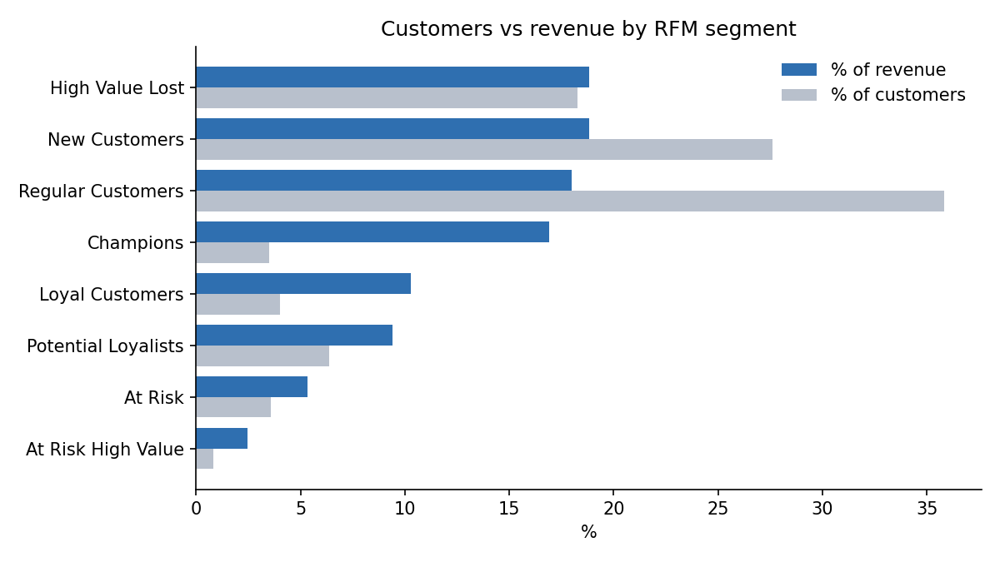
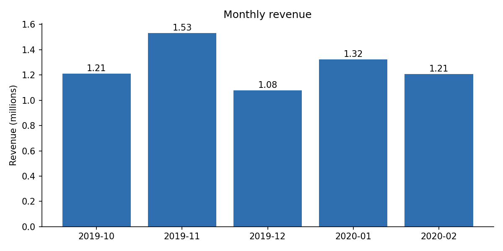
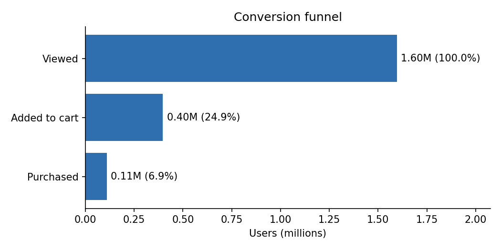

# Beauty E-Commerce Customer Intelligence

End-to-end customer analytics on **20.7 million shopping events** from a cosmetics online store (October 2019 – February 2020). The project cleans the raw event logs, segments **110,518 buying customers** with RFM analysis, measures repeat purchasing and cohort retention, and turns the findings into retention recommendations. Results feed a Power BI dashboard.

**Tools:** Python · pandas · matplotlib · SQL · Power BI · Jupyter

## Key findings

1. **Most customers buy once.** 78.9% of customers placed a single order. The 21.1% who repeat generate **48% of revenue** and spend 3.5x more per customer (131 vs 38).
2. **Champions are the most valuable group.** They are 3.5% of customers but **16.9% of revenue**, averaging 277 in spend and 5.8 orders.
3. **The biggest win-back pool is High Value Lost.** 20,189 customers made one high-value order and have been silent for ~118 days. They hold **18.8% of revenue**.
4. **Retention drops sharply after the first month.** Only 18.5% of October's customers bought again in month 2 (the best cohort); later cohorts retain 8.5–9.8%.
5. **Only 6.9% of visitors buy.** 24.9% of viewers add to cart, and about 28% of cart users go on to purchase.
6. **Brand preference is very consistent.** `runail` is the top brand in every one of the 8 segments (9.1% of sales overall), followed by `grattol` (7.0%) and `irisk` (5.9%).
7. **Weekdays beat weekends.** Thursday is the strongest sales day and Saturday the weakest; sales peak at 10:00–12:00 UTC.

## Charts

| | |
| --- | --- |
|  |  |
|  |  |


## RFM customer segments

Customers are scored 1–5 on **Recency** (days since last order), **Frequency** (number of *orders*) and **Monetary** (total spend). Recency and monetary use quintiles; frequency uses fixed bins (1, 2, 3, 4–5, 6+ orders) because most customers have exactly one order and quantile splits would divide identical customers.

| Segment | Customers | % Customers | % Revenue | Avg spend | Avg orders | Days since last order |
| --- | ---: | ---: | ---: | ---: | ---: | ---: |
| Regular Customers | 39,586 | 35.8% | 18.0% | 29 | 1.1 | 93 |
| New Customers | 30,508 | 27.6% | 18.8% | 39 | 1.0 | 26 |
| High Value Lost | 20,189 | 18.3% | 18.8% | 59 | 1.0 | 118 |
| Potential Loyalists | 7,060 | 6.4% | 9.4% | 85 | 2.0 | 25 |
| Loyal Customers | 4,456 | 4.0% | 10.3% | 146 | 3.2 | 38 |
| At Risk | 3,930 | 3.6% | 5.3% | 86 | 2.0 | 110 |
| Champions | 3,877 | 3.5% | 16.9% | 277 | 5.8 | 19 |
| At Risk High Value | 912 | 0.8% | 2.5% | 171 | 3.5 | 105 |

| Segment | Rule (R, F, M scores) |
| --- | --- |
| Champions | R ≥ 4, F ≥ 4 |
| Loyal Customers | R ≥ 3, F ≥ 3 |
| New Customers | R ≥ 4, F = 1 |
| Potential Loyalists | R ≥ 4, F = 2 |
| At Risk High Value | R ≤ 2, F ≥ 3, M ≥ 4 |
| At Risk | R ≤ 2, F ≥ 2 |
| High Value Lost | R ≤ 2, F = 1, M ≥ 3 |
| Regular Customers | everyone else |

## Monthly behavior

| Month | Customers | Orders | Revenue | Revenue / order |
| --- | ---: | ---: | ---: | ---: |
| 2019-10 | 25,762 | 29,326 | 1,210,922 | 41.29 |
| 2019-11 | 31,524 | 36,568 | 1,530,831 | 41.86 |
| 2019-12 | 25,613 | 28,894 | 1,077,689 | 37.30 |
| 2020-01 | 28,220 | 32,385 | 1,321,825 | 40.82 |
| 2020-02 | 25,759 | 29,401 | 1,207,001 | 41.05 |

November (Black Friday season) is the peak month for customers and revenue; December is the weakest, with the lowest revenue per order.

## Recommendations

| Segment | Action |
| --- | --- |
| Champions | Protect them: early access, loyalty rewards, referral offers. Avoid heavy discounting. |
| High Value Lost | Win-back campaign (email/SMS) built around the brand they bought, such as `runail` and `grattol`. |
| At Risk High Value | Personal outreach before they lapse; they already have 3+ orders. |
| New Customers | Second-order incentive within 30 days. Retention falls off sharply after month 1. |
| Potential Loyalists | Bundles and replenishment reminders to push them to a 3rd order. |
| Cart abandoners | Cart-recovery emails; roughly 72% of cart users never purchase. |
| Campaign timing | Send on Thursdays and mornings (UTC 10–12), when buying peaks. |

## Data and method notes

- **Source:** *eCommerce Events History in Cosmetics Shop* (Kaggle), 20,692,840 raw events.
- **Cleaning:** removed 104,288 rows with non-positive prices, 4,597 with no session ID and 898 duplicate purchases, leaving **1,285,982 purchase rows** across 110,518 customers.
- **Orders vs items:** each purchase row is one item, so an *order* is a distinct `user_session`. Counting items would badly overstate repeat buying.
- **Revenue** is the sum of item prices on purchase events (the dataset does not state a currency). Timestamps are UTC.
- **Limitations:** five months of data, so cohort and "lost" signals are short-window; `category_code` is missing for most purchases, so categories are shown by numeric `category_id`; there is no discount or margin data, so revenue is not profit.

## Project structure

```
├── src/
│   ├── pipeline.py        # clean data + build all analysis tables
│   └── charts.py          # charts for this README
├── notebooks/
│   └── 01_data_exploration.ipynb
├── sql/customer_analysis.sql
├── images/                # charts used above
├── outputs/               # generated tables (git-ignored; used by Power BI)
├── data/                  # raw monthly CSVs (git-ignored)
├── dashboard/             # Power BI files
└── requirements.txt
```

## How to run

```bash
pip install -r requirements.txt
# download the dataset from Kaggle and place the five monthly CSVs in data/
python src/pipeline.py     # ~ a few minutes; writes outputs/*.csv
python src/charts.py       # writes images/*.png
```

## Power BI dashboard

Load the CSVs in `outputs/` into Power BI. Suggested pages: customer overview, RFM segments, revenue by segment, repeat purchase, monthly trend, cohort retention, and brand/product performance by segment.
